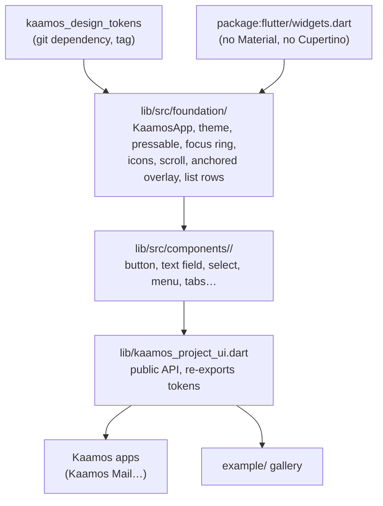

[Home](README.md) › Architecture

# Architecture

## Only the widgets layer

The library imports only `package:flutter/widgets.dart` (plus `services`, `rendering` where needed). Material and Cupertino bring their own look, platform differences and a lot of code; Kaamos must look identical everywhere. `test/architecture_test.dart` scans `lib/` and **fails CI** if a Material or Cupertino import slips in.

This is why the library has its own versions of things Material gives for free: `KaamosApp` (on `WidgetsApp`), the theme, focus rings, text selection handles and the copy/paste menu, scroll behaviour, icons.

## How a component is built

1. **Behaviour** comes from [`KaamosPressable`](foundation.md#kaamospressable): mouse, touch, Enter/Space, focus, semantics. It passes the active `WidgetState`s to a builder and draws nothing.
2. **Look** comes from the theme (`KaamosTheme.of(context)`, semantic fields) and the tokens (`KaamosColors`, `KaamosTypography`, `KaamosRadius`…).
3. **Focus** is shown with [`KaamosFocusRing`](foundation.md#kaamosfocusring), only for keyboard focus, painted outside the widget so the layout doesn't move.
4. **Accessibility** follows the same WAI-ARIA patterns as the web library (combobox, menu, tabs), expressed with Flutter `Semantics`.
5. **Performance**: `const` constructors, fixed-height rows with `ListView.builder` for long lists, no `Opacity`/`BackdropFilter`, rebuilds driven by `MediaQuery.sizeOf` or the theme only.

## Two kinds of overlays

| Kind | Used by | Built with | Why |
|---|---|---|---|
| Anchored | popover, menu, select | [`KaamosAnchoredOverlay`](foundation.md#anchored-overlays-kaamosanchoredoverlay): `OverlayPortal` + `CompositedTransformFollower` | Light: stays in the opener's tree (same theme), follows the anchor when scrolling, disappears with it |
| Route | dialog, command palette, nav drawer | `Navigator` route | Must block the page: back button, barrier and focus trap for free |

## Tokens

`kaamos_design_tokens` is generated by `open-design-tokens` and consumed as a git dependency at a tag (`path: dist/flutter`). `kaamos_project_ui.dart` re-exports it, so apps only depend on the UI library.

## Tests and golden files

- **Widget tests** check behaviour: keyboard, focus, semantics, callbacks.
- **Golden tests** check the look: they render a component and compare it pixel by pixel with a PNG in `goldens/`.
- `test/flutter_test_config.dart` runs before every test file and loads the real **Inter** font from the tokens package. By default Flutter tests use Ahem (every glyph is a square); goldens need the real font to be meaningful.
- Goldens are generated on Linux with the pinned Flutter version, because text rendering differs per OS.

The screenshots in the component pages are these golden files.

## The gallery

`example/` is a Flutter app showing every component, one file per group in `example/lib/sections/`. It runs on desktop, mobile and web; CI builds its web version to make sure it compiles.

## See also

- [Foundation](foundation.md)
- [Decisions](decisions.md)
- [Getting started](getting-started.md)
