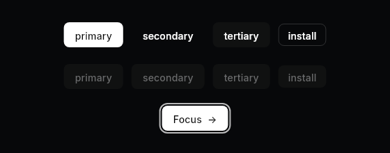
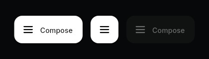

[Home](../README.md) › [Components](../README.md#components) › Button

# Button · `KaamosButton`

Action button. Equivalent of `<kaamos-button>` in open-ui-web.

```dart
KaamosButton(onPressed: save, child: const Text('Download'))
KaamosButton(
  onPressed: openDocs,
  variant: KaamosButtonVariant.secondary,
  trailing: const Text('→'),
  child: const Text('Learn more'),
)
KaamosButton(onPressed: null, child: const Text('Download')) // disabled
```



## Parameters

| Parameter       | Type                  | Default   | Notes                                           |
| --------------- | --------------------- | --------- | ----------------------------------------------- |
| `onPressed`     | `VoidCallback?`       | required  | `null` = disabled                               |
| `child`         | `Widget`              | required  | usually a `Text`                                |
| `variant`       | `KaamosButtonVariant` | `primary` | `primary`, `secondary`, `tertiary`, `install`   |
| `leading`       | `Widget?`             | `null`    | before the label, 8px apart                     |
| `trailing`      | `Widget?`             | `null`    | after the label, 8px apart                      |
| `focusNode`     | `FocusNode?`          | `null`    | to focus it from code                           |
| `autofocus`     | `bool`                | `false`   |                                                 |
| `semanticLabel` | `String?`             | `null`    | for screen readers, useful with icons only      |

Icons in `leading`/`trailing` get their colour and size (16px) from an `IconTheme`.

## Keyboard and accessibility

- Tab moves focus, Enter or Space activates it.
- The focus ring only appears when using the keyboard.
- Screen readers announce it as a button, with its enabled/disabled state.

## Guidelines (DESIGN.md)

- **Only one `primary` per screen**: white is reserved for the main action.
- `secondary` for light actions ("Learn more →"), `tertiary` for medium actions inside cards, `install` on store cards.
- Height 36px (install 32px) on every platform: already above the WCAG AA threshold (24px) for touch targets, so one density only.
- As on the web, there is no hover state: it wouldn't exist on touch, and the look stays identical everywhere.

## Floating action button · `KaamosFab`

The one main action of a screen ("Compose", "New task"), floating over the content in a corner.

```dart
Stack(children: [
  list,
  Positioned(
    right: 16,
    bottom: 16,
    child: KaamosFab(
      onPressed: compose,
      icon: const PencilIcon(),
      label: 'Compose',
      extended: !scrolledDown, // shrink to the icon while scrolling down
    ),
  ),
])
```



| Parameter       | Type            | Default  | Notes                                                    |
| --------------- | --------------- | -------- | -------------------------------------------------------- |
| `onPressed`     | `VoidCallback?` | required | `null` = disabled                                        |
| `icon`          | `Widget`        | required | gets colour and size (24px) from an `IconTheme`          |
| `label`         | `String?`       | `null`   | null = icon only                                         |
| `extended`      | `bool`          | `true`   | false hides the label, animated; the button stays put    |
| `focusNode`     | `FocusNode?`    | `null`   |                                                          |
| `autofocus`     | `bool`          | `false`  |                                                          |
| `semanticLabel` | `String?`       | `label`  | required in practice when there is no label              |

- **56px tall** (`KaamosFab.size`), radius `xl` (16px), `primary` colours like the primary button: so it counts as the screen's one primary action.
- The `label` stays the accessible name when the button is collapsed.
- It has the library's only shadow: it floats over rows that scroll under it, and a flat button would merge with them. The design system has no elevation tokens yet; if more floating components arrive, the shadow becomes a token.
- Collapsing uses `AnimatedSize` anchored on the left of the button. Place it with `right:` in a `Stack` so that it grows towards the left, away from the screen edge.
- It is mobile-first: on desktop the main action usually has room in a toolbar or sidebar.

## See also

- [Foundation](../foundation.md#kaamospressable): the behaviour under every button
- [Navigation](navigation.md): pill tabs and the nav bar
