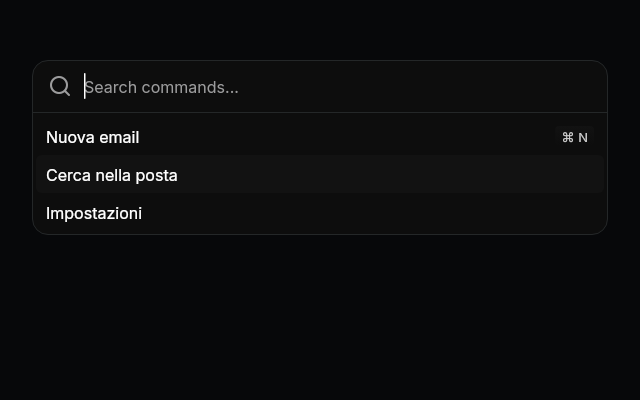

[Home](../README.md) › [Components](../README.md#components) › Command palette

# Command palette · `showKaamosCommandPalette`

The command palette: it opens with ⌘K (Ctrl+K on Linux and Windows), you type to filter, move with the arrows and pick with Enter. It is the signature component of DESIGN.md.

```dart
const commands = [
  KaamosCommand(value: 'new', label: 'New email', trailing: KaamosKeycap('⌘ N'), keywords: ['write']),
  KaamosCommand(value: 'search', label: 'Search mail'),
  KaamosCommand(value: 'settings', label: 'Settings'),
];

// With the ⌘K / Ctrl+K shortcut:
KaamosCommandPaletteShortcut<String>(
  commands: commands,
  onSelected: run,
  child: const HomePage(),
)

// Or from code:
final cmd = await showKaamosCommandPalette<String>(context: context, commands: commands);
```



## Commands · `KaamosCommand`

| Field      | Notes                                                 |
| ---------- | ----------------------------------------------------- |
| `value`    | What you get back when the command is chosen          |
| `label`    | The row's text, and what the search looks in         |
| `leading`  | Icon on the left                                      |
| `trailing` | Usually the shortcut's keycaps                        |
| `keywords` | Other words that find the command                     |

## Filter

By default (`kaamosContainsFilter`) a command matches if its label or a keyword **contains** the query, case-insensitively. You can pass your own:

```dart
showKaamosCommandPalette<String>(
  context: context,
  commands: commands,
  filter: (command, query) => command.label.toLowerCase().startsWith(query),
);
```

`query` arrives already lower-cased, trimmed, and never empty.

## Accessibility and performance

- Focus always stays in the search field (ARIA combobox pattern): you can keep typing while you move with ↑ ↓.
- It is a modal route: Esc, the back button or a click outside close it and return `null`.
- The list uses `ListView.builder` with fixed-height rows: it builds only the visible rows, so it stays fast even with thousands of commands.

## See also

- [Overlays](overlays.md)
- [Static components](static.md#keycap--kaamoskeycap)
