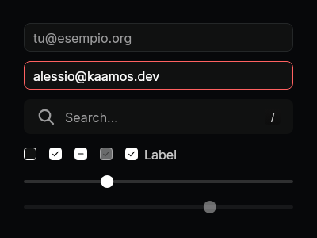
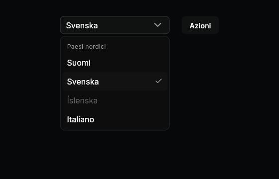

[Home](../README.md) › [Components](../README.md#components) › Form controls

# Form controls



## Text field · `KaamosTextField`

```dart
final email = TextEditingController();

KaamosTextField(
  controller: email,
  placeholder: 'you@example.org',
  semanticLabel: 'Email',
  keyboardType: TextInputType.emailAddress,
  autofillHints: const [AutofillHints.email],
  invalid: !isValidEmail(email.text),
)
```

| Parameter                         | Notes                                                   |
| --------------------------------- | ------------------------------------------------------- |
| `controller`                      | The text. If missing, the field creates its own         |
| `focusNode`                       | To give or take focus from code                         |
| `placeholder`                     | Disappears when you type: it is **not** a label         |
| `semanticLabel`                   | Label for screen readers                                |
| `enabled`, `readOnly`             | Disabled (grey, no focus) or read-only                  |
| `obscureText`                     | Password                                                |
| `invalid`                         | Red border                                              |
| `keyboardType`, `textInputAction` | Keyboard and action key on mobile                       |
| `onChanged`, `onSubmitted`        | On every change, and when you press Enter               |
| `maxLength`, `inputFormatters`    | Filters on the text                                     |
| `autofillHints`                   | System autofill                                         |

36px tall, `surfaceElevated` background, `hairline` border that becomes `hairlineStrong` on focus.

**How it's built**: underneath is `EditableText`, Flutter's text engine (cursor, system keyboard, emoji, shortcuts, accessibility). Gestures (tap, double tap, drag to select) come from `TextSelectionGestureDetectorBuilder`. The touch selection handles and the Cut/Copy/Paste menu are drawn by us, in the style of Kaamos menus. The menu labels come from `WidgetsLocalizations`: add `flutter_localizations` to your app to get them translated.

**Exception on the web**: the browser's menu (right click) stays, because our "Paste" would have to ask for permission to read the clipboard.

## Search bar · `KaamosSearchBar`

```dart
KaamosSearchBar(
  placeholder: 'Search...',
  semanticLabel: 'Search extensions',
  onChanged: filterList,
  onSubmitted: search,
  trailing: const KaamosKeycap('/'),
)
```

Magnifying glass on the left, 44px tall, transparent border that becomes `hairlineStrong` on focus. Esc clears the field; on mobile the keyboard shows "Search". Always set a `semanticLabel`.

## Checkbox · `KaamosCheckbox`

```dart
KaamosCheckbox(
  value: newsletter,
  onChanged: (v) => setState(() => newsletter = v!),
  label: const Text('Subscribe to the newsletter'),
)
```

- `onChanged: null` = disabled.
- `tristate: true` allows `value: null` ("partially"). The cycle is false → true → null → false.
- The box is 16×16, too small for a finger: pass a `label`, which becomes clickable too.

## Slider · `KaamosSlider`

```dart
KaamosSlider(
  value: volume,
  onChanged: (v) => setState(() => volume = v),
  min: 0,
  max: 1,
  divisions: 10,          // optional: jumps in steps
  semanticLabel: 'Volume',
)
```

Keyboard: ← → ↑ ↓ one step (one division, or 1%), PageUp/PageDown ten steps, Home/End minimum and maximum. Screen readers can increase and decrease the value.

## Select · `KaamosSelect`

```dart
KaamosSelect<String>(
  value: language,
  placeholder: 'Choose a language',
  semanticLabel: 'Language',
  onChanged: (v) => setState(() => language = v),
  options: const [
    KaamosSelectOption(value: 'fi', label: 'Suomi', group: 'Nordic countries'),
    KaamosSelectOption(value: 'sv', label: 'Svenska', group: 'Nordic countries'),
    KaamosSelectOption(value: 'is', label: 'Íslenska', enabled: false),
    KaamosSelectOption(value: 'it', label: 'Italiano'),
  ],
)
```

The list is drawn by us: identical everywhere, no iOS "wheel". It opens below the field (above if there is no room), at least as wide as the field, at most 288px tall. Consecutive options with the same `group` sit under a heading, like `<optgroup>`.

**Keyboard** (focus always stays on the field):

| Key               | List closed               | List open                                                      |
| ----------------- | ------------------------- | -------------------------------------------------------------- |
| ↓ ↑ Enter Space   | opens                     | ↓ ↑ move (skipping disabled options), Enter and Space choose   |
| Home / End        | opens on the first / last | first / last option                                            |
| PageUp / PageDown |                           | jumps by 10                                                    |
| Esc               |                           | closes without changing                                        |
| Tab               |                           | chooses the active option and moves on                         |
| Letters           | changes the value at once | moves the active option                                        |



Type to search: different letters search the start of the text ("sv" → Svenska), the same letter repeated cycles through the options starting with it. After half a second of pause it starts over.

## See also

- [Foundation](../foundation.md#anchored-overlays-kaamosanchoredoverlay): how the select list is positioned
- [Overlays](overlays.md)
