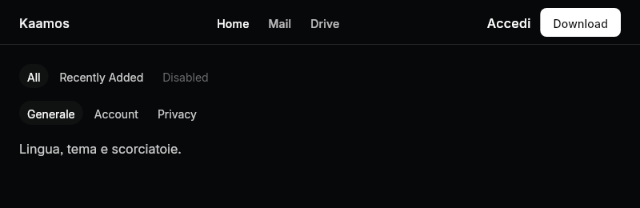

[Home](../README.md) › [Components](../README.md#components) › Navigation

# Navigation: tabs, pill tabs, main bar



## Pill tabs or tabs?

Use **pill tabs** when the buttons **filter the same list** ("All", "Most Popular"). Use **`KaamosTabs`** when each tab shows a **different panel**. They look the same, but for a screen reader one is a "pressed" toggle and the other a "selected" tab.

## Pill tab · `KaamosPillTab`

```dart
for (final f in filters)
  KaamosPillTab(
    label: f.label,
    selected: current == f,
    onPressed: () => setState(() => current = f),
  ),
```

## Tabs · `KaamosTabs`

```dart
KaamosTabs(
  semanticLabel: 'Account settings',
  labels: const ['General', 'Account', 'Privacy'],
  panels: const [GeneralPanel(), AccountPanel(), PrivacyPanel()],
  onChanged: (i) => print('tab $i'),
)
```

- **Keyboard**: Tab enters the active tab, the next Tab goes into the panel. ← → change tab wrapping around (immediate activation), Home and End go to the first and the last.
- **Trade-off**: only the visible panel is built, lighter than an `IndexedStack`. When you change tab, though, the state of the panel you left (scroll, unsaved text) is lost: if you need it, keep it outside the panel.
- On narrow screens the tabs scroll horizontally.

## Main bar · `KaamosNavBar`

```dart
KaamosNavBar(
  brand: const Text('Kaamos'),
  items: [
    KaamosNavItem(label: 'Home', onPressed: goHome, current: true),
    KaamosNavItem(label: 'Mail', onPressed: goMail),
  ],
  secondaryActions: [KaamosLink(label: 'Sign in', onPressed: login)],
  actions: [KaamosButton(onPressed: download, child: const Text('Download'))],
)
```

- 56px tall, `hairline` border at the bottom. Put it at the top of a `Column` to keep it always visible.
- **Below 768px** (`kaamosNavBreakpoint`): the logo moves to the centre, the hamburger button appears, the links go into a drawer that slides in from the left, and the `secondaryActions` disappear.
- The drawer is a route (`showKaamosNavDrawer`, built on [`showKaamosDrawer`](overlays.md#drawer--showkaamosdrawer)): it closes with the back button, a click on the scrim or Esc.
- The width is read with `MediaQuery.sizeOf`: the bar rebuilds only when the window size changes.

## See also

- [Button](button.md)
- [Static components](static.md#link--kaamoslink)
