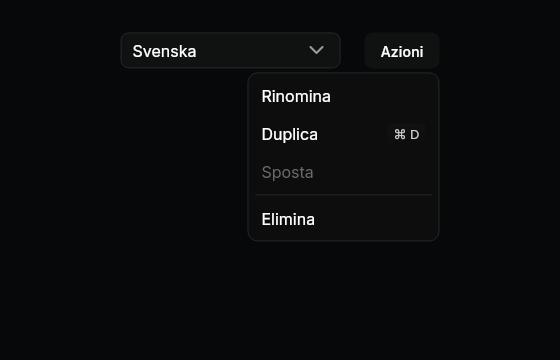
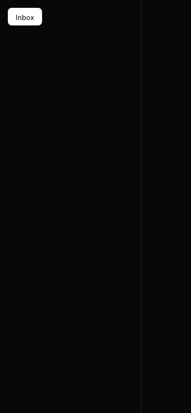

[Home](../README.md) › [Components](../README.md#components) › Overlays

# Overlays: popover, menu, dialog, drawer

| Component | When to use it                                                   | How it's built           |
| --------- | ---------------------------------------------------------------- | ------------------------ |
| Popover   | Information or light content next to a button                    | anchored `OverlayPortal` |
| Menu      | A list of actions that opens from a button                       | anchored `OverlayPortal` |
| Dialog    | An answer is needed before going on ("Delete the file?")         | Navigator route          |
| Drawer    | Navigation or a list of places on a phone, from the left         | Navigator route          |

**Why two techniques?** The dialog and the drawer must block the page: a route gives us Android's back button, the barrier that stops clicks and the focus trapped inside, for free. Popover and menu are light instead: they stay in the tree of whoever opens them (same theme, and they disappear if the button disappears) and follow the button when the page scrolls.



## Popover · `KaamosPopover`

```dart
KaamosPopover(
  content: const Text('Help text next to the button.'),
  builder: (context, overlay) => KaamosButton(
    variant: KaamosButtonVariant.tertiary,
    onPressed: overlay.toggle,
    child: const Text('Info'),
  ),
)
```

It closes with the button, a click outside or Esc. At most 320px wide, 16px padding.

## Menu · `KaamosMenu`

```dart
KaamosMenu(
  semanticLabel: 'File actions',
  items: [
    KaamosMenuItem(label: 'Rename', onPressed: rename),
    KaamosMenuItem(label: 'Duplicate', onPressed: duplicate, trailing: const KaamosKeycap('⌘ D')),
    const KaamosMenuItem(label: 'Move', onPressed: null), // disabled
    const KaamosMenuDivider(),
    KaamosMenuItem(label: 'Delete', onPressed: delete),
  ],
  builder: (context, overlay) => KaamosButton(
    variant: KaamosButtonVariant.tertiary,
    onPressed: overlay.toggle,
    child: const Text('Actions'),
  ),
)
```

- **Keyboard**: on open, focus goes to the first item. ↑ ↓ move, wrapping around and skipping disabled items; Home and End go to the start and the end; Enter chooses; Esc closes and returns focus to the button; Tab closes and moves on.
- Choosing an item closes the menu and then calls `onPressed`.

## Dialog · `showKaamosDialog` + `KaamosDialog`

```dart
final ok = await showKaamosDialog<bool>(
  context: context,
  builder: (context) => KaamosDialog(
    title: 'Delete the file?',
    content: const Text('You can restore it from the trash for 30 days.'),
    actions: [
      KaamosButton(
        variant: KaamosButtonVariant.secondary,
        onPressed: () => Navigator.pop(context, false),
        child: const Text('Cancel'),
      ),
      KaamosButton(
        onPressed: () => Navigator.pop(context, true),
        child: const Text('Delete'),
      ),
    ],
  ),
);
if (ok ?? false) deleteFile();
```

- `await` returns what you pass to `Navigator.pop`, like `dialog.returnValue` on the web. Esc, the back button or a click on the scrim return `null` (`barrierDismissible: false` prevents it).
- The title is also the dialog's name for screen readers.
- **Only one primary button**: the main action.
- At most 448px wide, 16px from the screen edges. The scrim is `canvas` at 70%.

## Drawer · `showKaamosDrawer`

A panel that slides in from the left over a dimmed page. Use it on phones for navigation: folders, sections, accounts.

```dart
final folder = await showKaamosDrawer<Folder>(
  context: context,
  barrierLabel: 'Close folders',
  builder: (context) => FolderList(
    onSelected: (f) => Navigator.of(context).pop(f),
  ),
);
```



- **85% of the screen width, at most 288px** (`kaamosDrawerMaxWidth`, `maxWidth` to change it): the page stays visible on the right, so the user sees where they go back to.
- The scrim is `theme.scrim`, as for the dialog. A tap on it, Esc or the back button close the drawer with `null`.
- Close it from the content with `Navigator.of(context).pop(result)`, using the `context` the builder receives. `await` returns the result.
- The content goes inside a `SafeArea` and a `Semantics(scopesRoute: true)`; it gets no padding, so lists can reach the edges.
- `KaamosDrawerPanel` is the panel without the route, if you need the same look elsewhere.
- `showKaamosNavDrawer` (the nav bar's mobile menu) is built on it.

## See also

- [Foundation](../foundation.md#anchored-overlays-kaamosanchoredoverlay)
- [Command palette](command-palette.md)
- [Navigation](navigation.md): the nav bar's drawer
