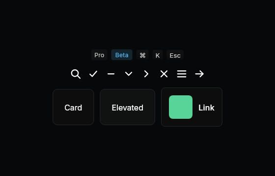
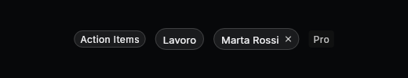

[Home](../README.md) › [Components](../README.md#components) › Static components

# Static components

Widgets with no behaviour (or almost): only look. They are the equivalent of open-ui-web's static classes.



## Badge · `KaamosBadge`

```dart
const KaamosBadge('Pro')
const KaamosBadge('Beta', variant: KaamosBadgeVariant.info)
```

| Variant | Use                                                           |
| ------- | ------------------------------------------------------------- |
| `pro`   | Plan or tier: "Pro", "Pro+", "Free"                           |
| `info`  | Rare label: "New", "Beta". Uses the blue accent: keep it rare |

## Chip · `KaamosChip`

```dart
const KaamosChip('Work')                                   // a label
const KaamosChip('Work', size: KaamosChipSize.small)       // in a dense row
KaamosChip(
  'Marta Rossi',
  semanticLabel: 'Marta Rossi, marta@example.org',
  onRemove: () => remove(marta),
  removeLabel: 'Remove Marta Rossi',
)
```



A short value the user has or picked: a label, a recipient, an attached file.

| Parameter       | Type             | Default          | Notes                                         |
| --------------- | ---------------- | ---------------- | --------------------------------------------- |
| `label`         | `String`         | required         | cut with an ellipsis at `maxWidth`            |
| `size`          | `KaamosChipSize` | `medium`         | `small` 22px (dense rows), `medium` 28px      |
| `onRemove`      | `VoidCallback?`  | `null`           | shows an X; null = no X                       |
| `removeLabel`   | `String?`        | "Remove `label`" | the X's name for screen readers               |
| `semanticLabel` | `String?`        | `label`          | when the text is not enough                   |
| `maxWidth`      | `double`         | `240`            | the widest the text gets                      |

**Chip or badge?** A badge is a tiny marker ("Pro", "Beta") that barely stands out on purpose: its fill (`surfaceElevated`) is almost the canvas. A chip is content, so it must be seen on the dark canvas: `hairlineSoft` fill (white 8%), `hairlineStrong` border (white 16%) and `ink` text. The X is its own button for screen readers, at least 24px in the medium size.

## Keycap · `KaamosKeycap`

```dart
const Row(spacing: 4, children: [
  KaamosKeycap('⌘', semanticLabel: 'Command'),
  KaamosKeycap('K'),
])
```

20px tall, at least 20px wide. Give symbols a `semanticLabel`: "⌘" means nothing to a screen reader.

## App icon tile · `KaamosAppIconTile`

```dart
KaamosAppIconTile(child: Image.asset('assets/mail.png'))
KaamosAppIconTile(size: KaamosAppIconTileSize.large, child: ...)
```

48×48 (`medium`) or 64×64 (`large`). The icon fills the tile, clipped at the corners.

## Card · `KaamosCard`

```dart
KaamosCard(child: ...)                                          // feature-card-dark, pricing-tier-card
KaamosCard(variant: KaamosCardVariant.elevated, child: ...)     // feature-card-elevated, featured plan
KaamosCard(variant: KaamosCardVariant.compact, child: Row(...)) // store-extension-card
```

One frame, the content changes. No shadows: depth comes from the surface scale and the `hairline` border.

## Link · `KaamosLink`

```dart
KaamosLink(label: 'Read the documentation', onPressed: openDocs)
```

`onDark` text in link-md, underlined on mouse hover. For screen readers it is a "link". Flutter doesn't know about URLs: what happens on click is decided by `onPressed` (a page of your app, or the browser with a package like `url_launcher`).

## See also

- [Button](button.md)
- [Command palette](command-palette.md): keycaps in commands
